<div align="center">


# Repo Brain

**Give Claude Desktop your GitHub code and your team's internal knowledge · updates only when you press the button · uses each person's own Claude account, no API key**<br>
**ให้ Claude Desktop รู้จักโค้ดใน GitHub และความรู้ภายในของทีมคุณ · อัปเดตเมื่อกดปุ่มเท่านั้น · ไม่ต้องมี API key**

**English** · [ภาษาไทย](README.th.md)


-000000?logo=apple&logoColor=white)


<br>

<a href="https://github.com/madara1150/repo-brain/releases/latest/download/RepoBrain-Windows-Setup.exe"></a>
&nbsp;
<a href="https://github.com/madara1150/repo-brain/releases/latest/download/RepoBrain-macOS.dmg"></a>

<sub>Windows portable: <a href="https://github.com/madara1150/repo-brain/releases/latest/download/RepoBrain-Windows-Portable.zip">RepoBrain-Windows-Portable.zip</a> · All versions: <a href="https://github.com/madara1150/repo-brain/releases">Releases</a></sub>

<br><br>

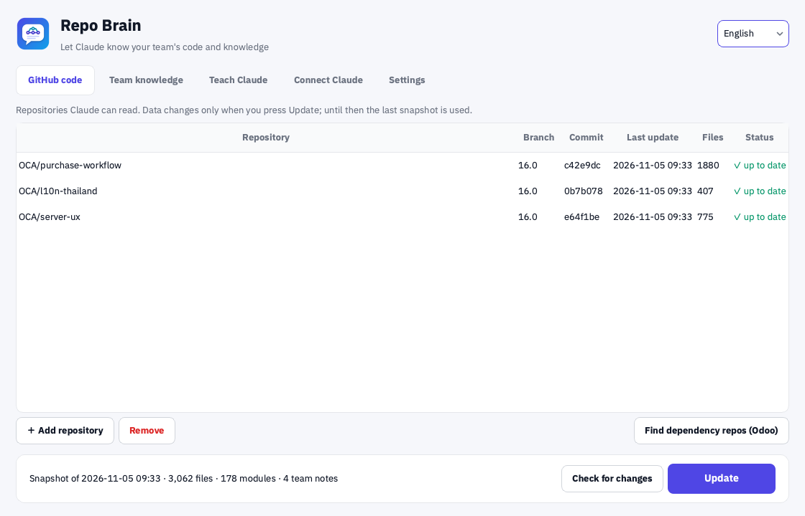

</div>

---

## Contents

- [What it does](#-what-it-does)
- [How it works](#-how-it-works)
- [Install](#-install)
- [Quick start: teammates who received a settings file](#-quick-start-teammates-who-received-a-settings-file)
- [First-time setup (admin)](#-first-time-setup-admin)
- [Everyday use: ask questions in Claude Desktop](#-everyday-use-ask-questions-in-claude-desktop)
- [Teach Claude: LINE cases and work flows](#-teach-claude-line-cases-and-work-flows)
- [FAQ / Troubleshooting](#-faq--troubleshooting)
- [Build it yourself](#️-build-it-yourself-developers)

---

## ✨ What it does

| ✨ Feature | Description |
|---|---|
| 🧠 **Claude knows your code** | Add GitHub repositories and Claude Desktop can search and read them, citing `repo/path:line`. |
| 🔘 **Updates only on demand** | Day to day the last local snapshot is used. Press **Update** to fetch only the files that changed — fast. |
| 🔔 **Knows when there's news** | **Check for changes** shows which repositories have new commits without downloading code. |
| 🧩 **Understands Odoo** | Where each model is defined and `_inherit`ed, its fields, module dependencies; Thai labels are searchable via `th.po` and views. |
| 🔗 **Finds missing OCA repos** | Reads `depends` and tells you which OCA repository ships each missing module for your Odoo version. |
| 👥 **Shared team knowledge** | Everyone can add notes, stored in a private GitHub repository or a shared folder; everyone gets them on Update. |
| 🎓 **Teach Claude from real cases** | Open a LINE chat export; the app splits it into cases and hides names, phone numbers and emails. Claude analyzes, asks until it understands, and saves after you confirm. |
| 🗺️ **Teach a work flow** | Claude interviews you step by step until it can explain the flow back correctly, then writes it up for the team. |
| 📦 **One file sets up the team** | The admin exports a `.repobrain` file; teammates import it and get the repositories, team knowledge and token. |
| 🔑 **Each person's own Claude** | Runs as a Claude Desktop MCP server, using each person's own account and quota — no shared API key. |
| 🔒 **Data stays local** | The index lives on your computer, no central server. `.env` files, keys and binaries are skipped automatically. |

---

## 🧭 How it works

```
GitHub (code + team notes) ──press “Update”──▶ Repo Brain (local index)
                                                  │  MCP
                                                  ▼
                                        your Claude Desktop ◀── you ask
```

- **Repo Brain** is the back end: it stores the code and knowledge, has the Update button and the teaching tools.
- **Claude Desktop** is the chat: you ask there, and Claude looks things up in Repo Brain by itself.

---

## 📥 Install

You need [Claude Desktop](https://claude.ai/download) installed and signed in.

**macOS 11+ (Apple Silicon)**
1. Download [RepoBrain-macOS.dmg](https://github.com/madara1150/repo-brain/releases/latest/download/RepoBrain-macOS.dmg) and open it.
2. Drag **Repo Brain** into **Applications** (required — don't run it from inside the .dmg).
3. First launch: right-click **Repo Brain** in Applications → **Open** → **Open** (the app isn't notarized yet; once only).

**Windows 10 / 11**
1. Download [RepoBrain-Windows-Setup.exe](https://github.com/madara1150/repo-brain/releases/latest/download/RepoBrain-Windows-Setup.exe) and run it.
2. If you see “Windows protected your PC”, click **More info** → **Run anyway**.
3. Click through the installer and start **Repo Brain** from the Start menu.

---

## ⚡ Quick start: teammates who received a settings file

If your admin sent you a `.repobrain` file, five steps are enough:

1. Open Repo Brain → **Settings** → **Import team settings…** and pick the file.

   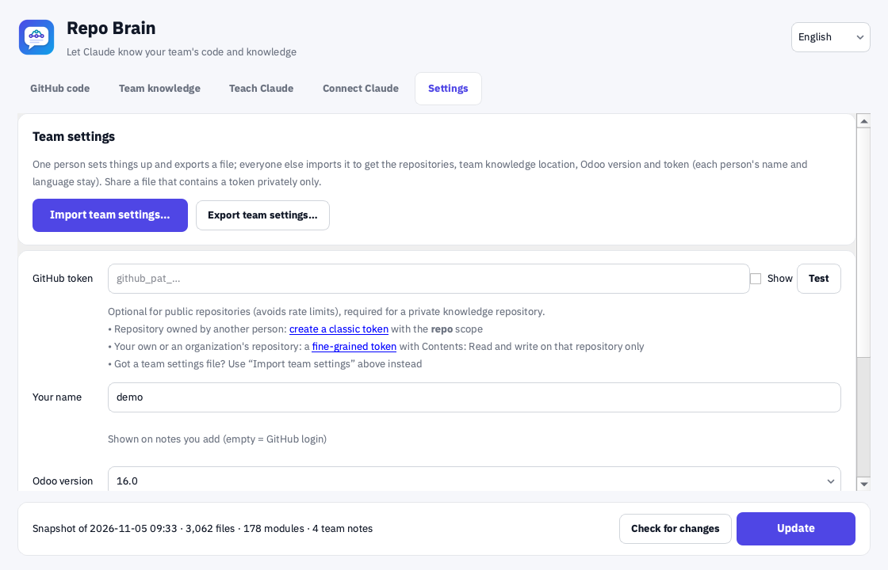

2. Check the summary and press **Yes**.

   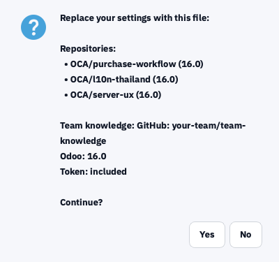

3. Fill in **Your name** (shown on notes you add).
4. Press **Update** in the bar at the bottom and wait for it to finish.
5. Do [step 7: Connect Claude Desktop](#7-connect-claude-desktop), then start [asking questions](#-everyday-use-ask-questions-in-claude-desktop).

---

## 🛠️ First-time setup (admin)

Done once by whoever looks after the system, then exported for the whole team.

### 1. Add your repositories

**GitHub code** tab → **＋ Add repository** → enter `owner/name` or paste a GitHub URL → branch (empty = the default branch) → **OK**

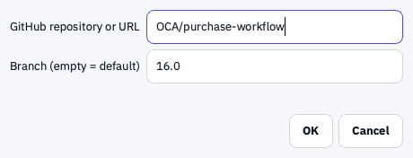

### 2. Press “Update”

The first update downloads the whole repository (a few seconds for thousands of files). You can **Cancel** meanwhile.

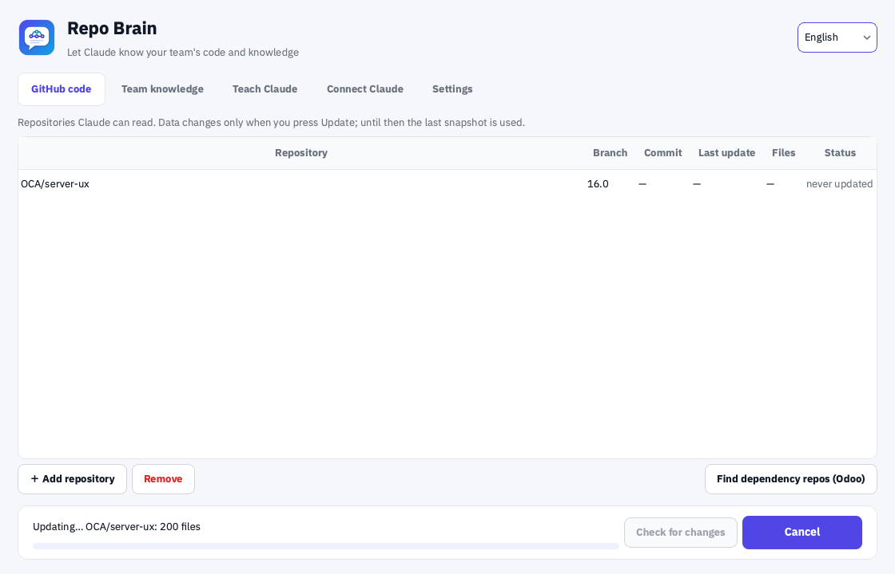

When it's done the table shows the commit, last update and file count; the bottom bar summarizes everything.


> Later, press **Check for changes** to see which repositories have new commits, then **Update** — only changed files are fetched.

### 3. (Odoo) Add the OCA repositories your modules need

1. **Settings** → set **Odoo version** (e.g. 16.0).
2. **GitHub code** → **Find dependency repos (Odoo)**.
3. Tick the repositories → **Add selected** → press **Update** again.

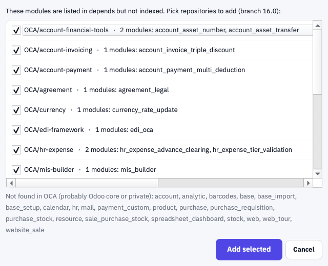

Modules not found in OCA (such as `account`, `purchase`) are Odoo core — nothing to add.

### 4. Choose where team knowledge lives

1. Create a **private** GitHub repository such as `team-knowledge` (never public — it holds internal data).
2. **Team knowledge** tab → **Private GitHub repository (recommended)** → enter `owner/team-knowledge` → keep the subfolder `knowledge`.

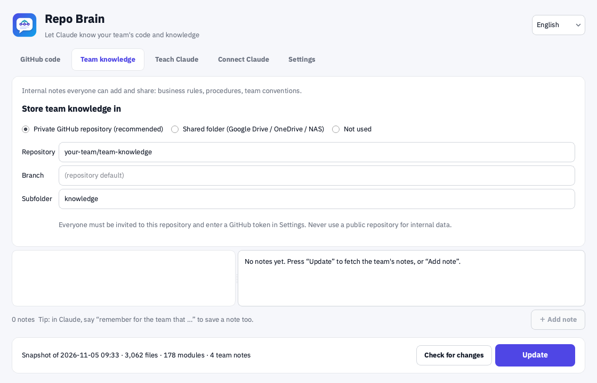

> Alternative: a **shared folder** (Google Drive / OneDrive / NAS) needs no token but keeps no edit history.

### 5. Create a GitHub token

We recommend one **shared token** created by the admin and handed out through the team settings file.

1. Open [create a fine-grained token](https://github.com/settings/personal-access-tokens/new).
2. **Repository access** → **Only select repositories** → `team-knowledge`.
3. **Permissions** → **Contents: Read and write** (nothing else).
4. Set an **Expiration** (e.g. 1 year) → **Generate token** → copy it.
5. **Settings** → paste into **GitHub token** → **Test** should say “Works — signed in as …”.


> Without a shared token: for a repository owned by someone else's account, teammates need a [classic token](https://github.com/settings/tokens/new?scopes=repo&description=Repo%20Brain) with the `repo` scope (fine-grained tokens can't reach another user's repositories). In a GitHub organization, everyone can use fine-grained tokens.

### 6. Export the settings file for the team

**Settings** → **Export team settings…** → choose whether to include the token → save the `.repobrain` file.

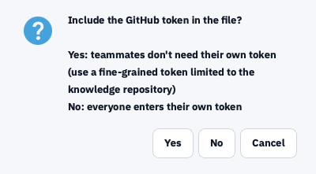

Send the file **privately only** (it contains the token). Your name and language are not included.

### 7. Connect Claude Desktop

Everyone does this on their own computer.

1. **Connect Claude** tab → **Connect to Claude Desktop**.

   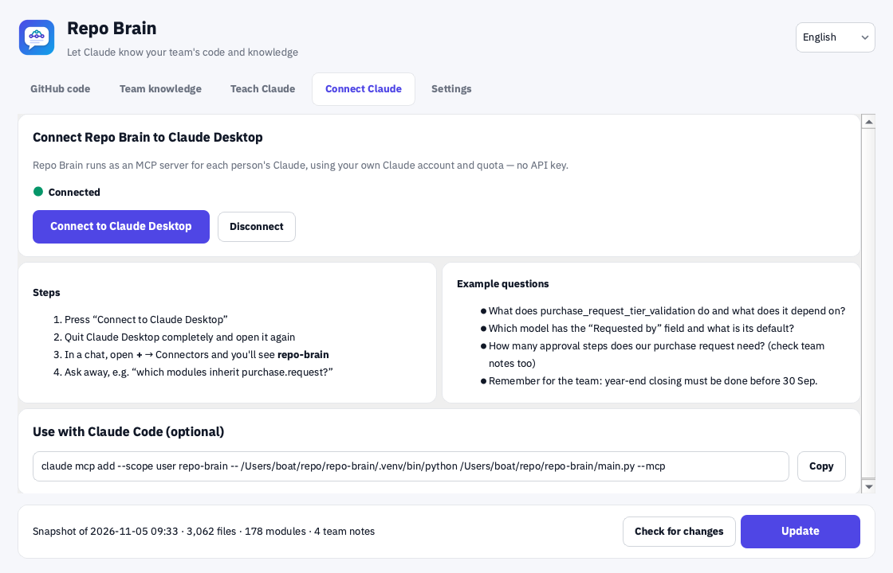

2. A “Connected” message appears → **OK**.

   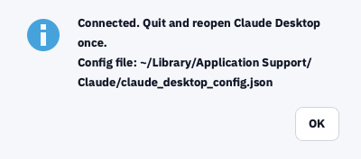

3. **Quit Claude Desktop completely** and open it again once.
   - macOS: with Claude in front, press **⌘Q**.
   - Windows: right-click the Claude icon in the system tray → **Quit**.
4. In Claude Desktop start a new chat → press **+** below the message box → **Connectors** → check that **repo-brain** is listed and on.

---

## 💬 Everyday use: ask questions in Claude Desktop

1. Open **Claude Desktop** → new chat.
2. Ask in plain language, for example
   - “Confirming a purchase request fails with ‘no source of funds selected’ — what do I do?”
   - “Which modules inherit `purchase.request`?”
   - “Which model has the ‘Requested by’ field and what's its default?”
   - “How many approval steps does our purchase request need? (check team notes too)”
3. The first time Claude uses repo-brain it asks for permission → **Allow** (you can allow it always).
4. Claude answers with its sources, such as `repo/path:line` or the team note's title.

**Ask Claude to remember something short:** say “remember for the team that …”; Claude drafts a note, and saves it once you confirm.

**Add a note yourself:** **Team knowledge** → **＋ Add note** → title, tags, content → **Save and share**.

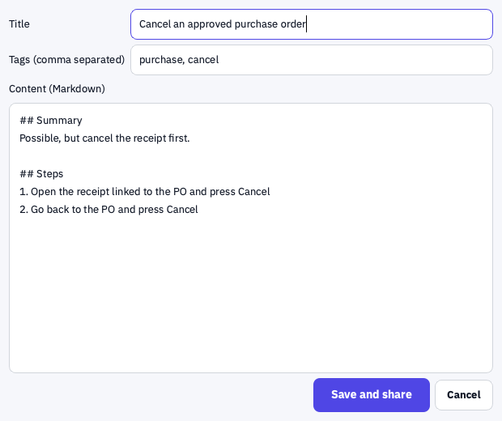

**Keep it current:** when code changes or someone adds a note, press **Check for changes** → **Update** in the app. No need to restart Claude Desktop.

---

## 🎓 Teach Claude: LINE cases and work flows

The **Teach Claude** tab turns real Q&A and what's in people's heads into team notes.


### A. Cases from LINE chats

1. **Export the chat from LINE**
   - Phone: open the chat/group → **≡** (top right) → **Settings** → **Export chat history** → send the .txt to your computer.
   - LINE for PC/Mac: open the chat → **⋮** → **Save chat**.
2. In Repo Brain, **Teach Claude** → **Open LINE export (.txt)…** (or copy text from LINE and use **Paste chat text…**).
3. The app splits the chat into cases by day and time gaps; names become “คน A / คน B” and phone numbers, emails, ID and account numbers are hidden.
4. Pick a case on the left → **read it** and remove anything unrelated on the right → **Copy for Claude to analyze**.

   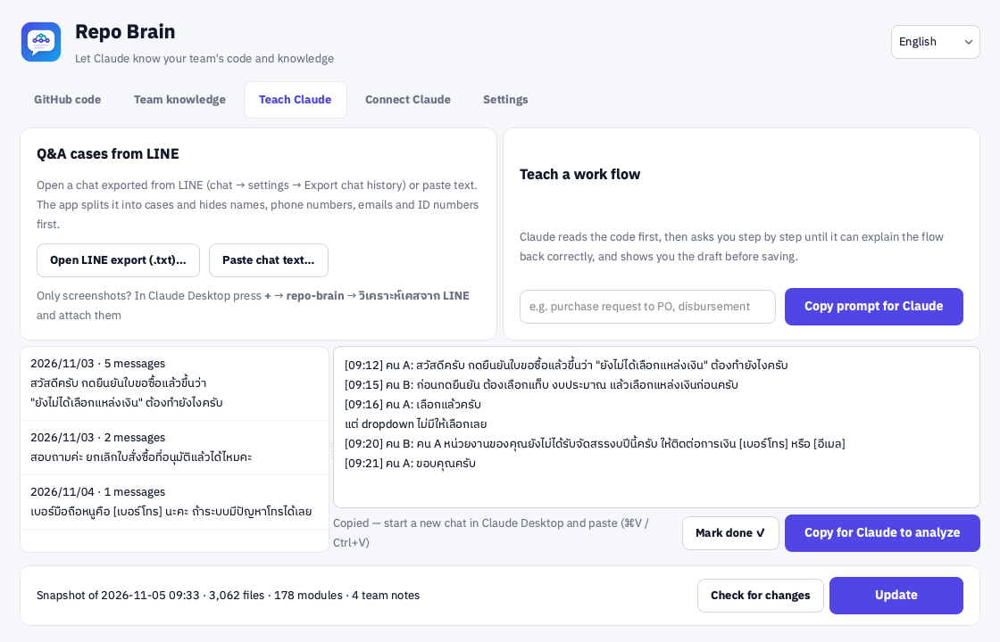

5. Start a **new chat** in Claude Desktop → paste (⌘V / Ctrl+V) → send.
6. Answer Claude's questions (1–3 at a time) until it summarizes the case correctly.
7. Claude shows the **full draft** → ask for changes, or reply “save” when it's right.
8. Claude saves it to the team's knowledge repository → back in the app press **Mark done ✓**; the next case is selected.

> Only screenshots? In Claude Desktop press **+** → **repo-brain** → **วิเคราะห์เคสจาก LINE** and attach them (images are not redacted automatically — blur names and numbers first).

### B. Teach a work flow

1. **Teach Claude** → type the flow's name, e.g. “purchase request to PO” → **Copy prompt for Claude**
   (or in Claude Desktop: **+** → **repo-brain** → **สอน flow การทำงาน**).
2. Paste into a new Claude Desktop chat → send.
3. Claude reads the code first and describes how the system probably works, so you **correct it** instead of explaining from scratch.
4. It asks in order: who starts → what they do in the system → who's next → how many approvals → where it ends → returns/cancellations.
5. Every 2–3 rounds it summarizes for you to check; finally it **explains the whole flow back** until you say it's right.
6. Claude shows the draft → you confirm → it's saved to the team's knowledge repository.

### Rules Claude follows every time

- Checks against the real code and says so when your description doesn't match it.
- Searches existing notes first; for the same topic it proposes **updating the existing note**.
- No names, phone numbers, emails or individual document numbers — roles instead (e.g. “procurement officer”).
- **Never saves before you confirm**; notes carry a type (`case`, `flow`, `rule`, `howto`, `faq`) and related modules.

Tools Claude uses: `repo_status`, `search_code`, `read_file`, `list_files`, `list_modules`, `odoo_module`, `odoo_model`, `search_knowledge`, `list_knowledge`, `add_knowledge`, `update_knowledge`, `check_for_updates`, plus the prompts `analyze_line_case` and `teach_flow`.

---

## ❓ FAQ / Troubleshooting

<details>
<summary><b>macOS says the app “can't be opened because it is from an unidentified developer”</b></summary>

Right-click **Repo Brain** in Applications → **Open** → **Open** (once), or **System Settings → Privacy & Security** → **Open Anyway**.
</details>

<details>
<summary><b>Windows shows “Windows protected your PC” (SmartScreen)</b></summary>

Click **More info** → **Run anyway**. The program has no code-signing certificate yet.
</details>

<details>
<summary><b>Claude Desktop doesn't show repo-brain</b></summary>

1. **Quit** Claude Desktop completely and reopen it (closing the window isn't enough).
2. The app's **Connect Claude** tab must say “Connected”; if it says it points at another copy, connect again.
3. After moving or updating the app, press **Connect to Claude Desktop** again.
4. On macOS, move the app into Applications before connecting.
</details>

<details>
<summary><b>Claude can't find something, or the answer is outdated</b></summary>

Claude uses your last local snapshot: press **Check for changes** → **Update** and ask again. If the module lives in another repository, add that repository first.
</details>

<details>
<summary><b>Adding a note fails with 401, 403 or 404</b></summary>

Use **Test** next to the token in **Settings**: the token must not be expired, must reach the knowledge repository and have *Contents: Read and write*.
</details>

<details>
<summary><b>Update fails with “rate limit”</b></summary>

GitHub allows 60 requests per hour without a token. Add a token in **Settings** to get 5,000 per hour.
</details>

<details>
<summary><b>The LINE export is split into the wrong cases</b></summary>

LINE versions write dates slightly differently. If the split is wrong, copy just the part of the chat you need and use **Paste chat text…** instead.
</details>

<details>
<summary><b>Where does my data go?</b></summary>

The index stays on your computer. The app only contacts GitHub (update, check, add note) and PyPI (finding OCA repositories). What Claude reads goes through Claude Desktop under your own account. **Never keep internal data in a public repository.**
</details>

<details>
<summary><b>Does it work with Claude Code?</b></summary>

Yes — the **Connect Claude** tab has a ready-to-copy `claude mcp add …` command.
</details>

---

## 🛠️ Build it yourself (developers)

```bash
python3 -m venv .venv && .venv/bin/pip install -r requirements.txt pytest Pillow
.venv/bin/python main.py            # run the app
.venv/bin/python main.py --mcp      # MCP server (started by Claude Desktop)
.venv/bin/python main.py --sync     # update without the window
QT_QPA_PLATFORM=offscreen .venv/bin/python -m pytest
QT_QPA_PLATFORM=offscreen .venv/bin/python tools/screenshots.py   # main screenshots
QT_QPA_PLATFORM=offscreen .venv/bin/python tools/guide_shots.py   # step-by-step guide screenshots
./build_mac.sh                      # → dist/RepoBrain-macOS.dmg
build_windows.bat                   # → dist\RepoBrain-Windows-Setup.exe + RepoBrain\ (portable)
```

Push a tag such as `v1.0.4` and GitHub Actions builds both platforms and publishes the Release.

---

## 📄 License

[MIT](LICENSE) © 2026 Tanathip · Fonts: IBM Plex Sans Thai ([OFL](assets/fonts/OFL-IBMPlexSansThai.txt))
