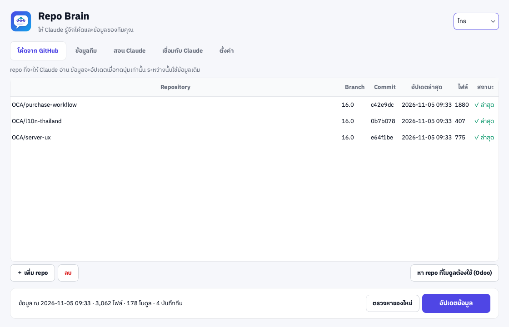
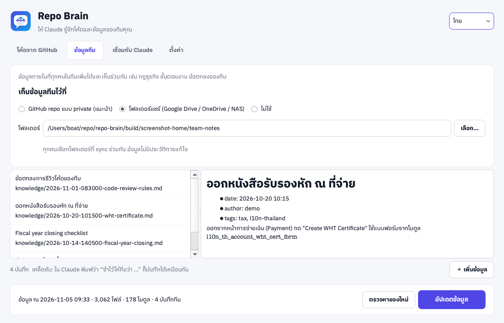
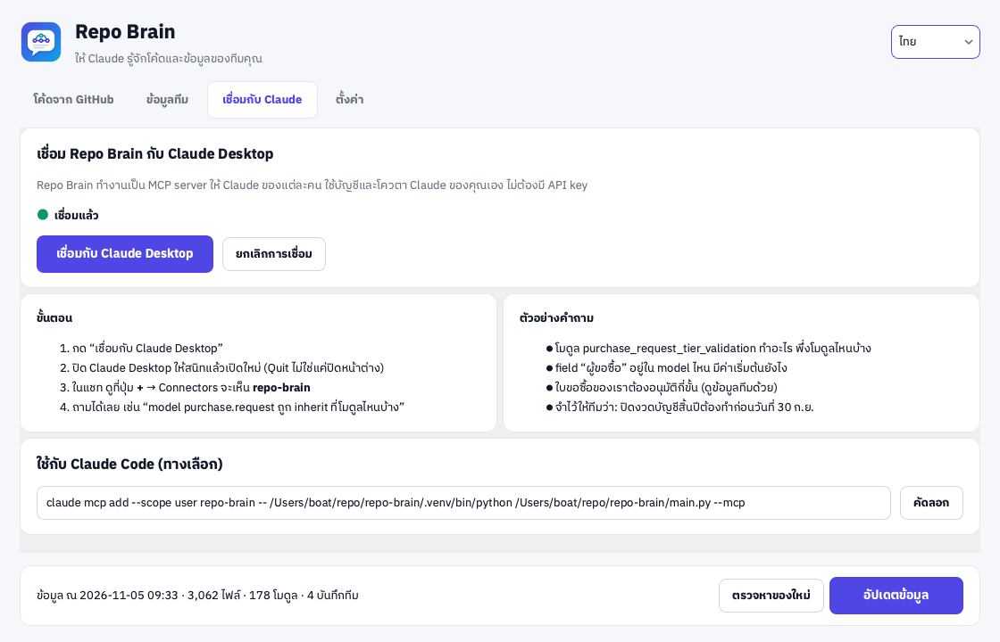
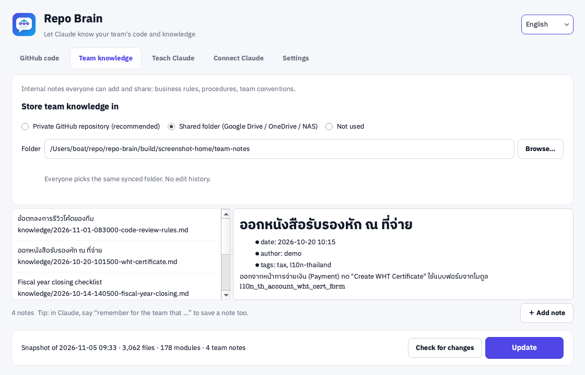
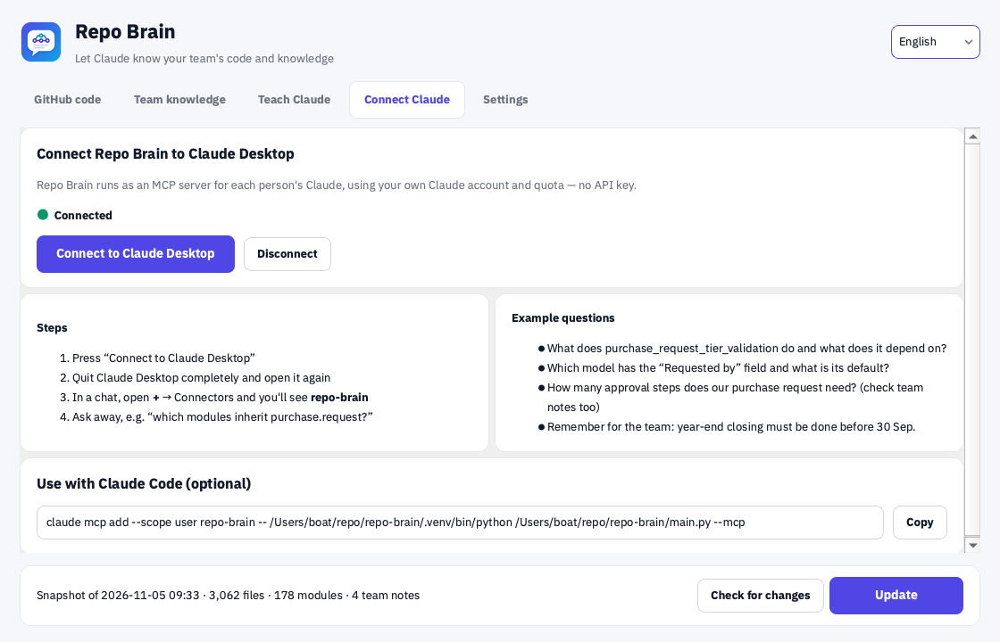

<div align="center">


# Repo Brain

**ให้ Claude Desktop รู้จักโค้ดใน GitHub และข้อมูลภายในของทีมคุณ · อัปเดตเมื่อกดปุ่มเท่านั้น · ใช้บัญชี Claude ของแต่ละคน ไม่ต้องมี API key**<br>
**Give Claude Desktop your GitHub code and your team's internal knowledge · updates only when you press the button · uses each person's own Claude account, no API key**


-000000?logo=apple&logoColor=white)


[ภาษาไทย](#-ภาษาไทย) · [English](#-english)

<br>

<a href="https://github.com/madara1150/repo-brain/releases/latest/download/RepoBrain-Windows-Setup.exe"></a>
&nbsp;
<a href="https://github.com/madara1150/repo-brain/releases/latest/download/RepoBrain-macOS.dmg"></a>

<sub>Windows แบบไม่ต้องติดตั้ง / Portable: <a href="https://github.com/madara1150/repo-brain/releases/latest/download/RepoBrain-Windows-Portable.zip">RepoBrain-Windows-Portable.zip</a> · ทุกเวอร์ชัน / All versions: <a href="https://github.com/madara1150/repo-brain/releases">Releases</a></sub>

<br><br>



</div>

---

## 🇹🇭 ภาษาไทย

### ✨ ทำอะไรได้บ้าง

| ✨ ฟีเจอร์ | คำอธิบาย |
|---|---|
| 🧠 **Claude รู้จักโค้ดของคุณ** | เพิ่ม repo จาก GitHub แล้ว Claude Desktop ค้นหาและอ่านโค้ดได้ ตอบพร้อมอ้างอิง `repo/path:บรรทัด` |
| 🔘 **อัปเดตเมื่อกดปุ่มเท่านั้น** | ปกติใช้ข้อมูลชุดล่าสุดที่มีในเครื่อง พอกด **อัปเดตข้อมูล** จะดึงมาเฉพาะไฟล์ที่เปลี่ยนตั้งแต่ commit ก่อน จึงเร็วมาก |
| 🔔 **รู้ว่ามีของใหม่** | ปุ่ม **ตรวจหาของใหม่** บอกว่า repo ไหนมี commit ใหม่ โดยไม่โหลดโค้ด Claude เองก็ถามได้ |
| 🧩 **เข้าใจ Odoo** | รู้ว่า model ถูกสร้างและถูก `_inherit` ที่โมดูลไหน มี field อะไร โมดูลพึ่งโมดูลไหน ค้นป้ายภาษาไทยจาก `th.po` และ view ได้ |
| 🔗 **หา repo ของ OCA ที่ขาดให้** | อ่าน `depends` แล้วบอกว่าโมดูลที่ขาดอยู่ใน repo ไหนของ OCA ตรงตามเวอร์ชัน Odoo แล้วเพิ่มได้ในคลิกเดียว |
| 👥 **ข้อมูลทีมที่แชร์กัน** | ทุกคนเพิ่มบันทึกได้ เช่น กฎธุรกิจ ขั้นตอนงาน ข้อตกลงของทีม เก็บใน GitHub repo แบบ private หรือโฟลเดอร์แชร์ แล้วทุกคนได้ข้อมูลเมื่อกดอัปเดต |
| 💬 **บอก Claude ให้จำ** | พิมพ์ใน Claude ว่า “จำไว้ให้ทีมว่า …” แล้วบันทึกจะถูกแชร์ให้ทั้งทีม |
| 🔑 **ใช้ Claude ของแต่ละคน** | ทำงานเป็น MCP server ของ Claude Desktop จึงใช้บัญชีและโควตาของแต่ละคนเอง ไม่ต้องมี API key กลาง |
| 🔒 **ข้อมูลอยู่ในเครื่อง** | index เก็บในเครื่องคุณ ไม่มี server กลาง ข้ามไฟล์ `.env`, key และไฟล์ binary ให้อัตโนมัติ |

<p align="center">
  
</p>

### 🧭 ทำงานยังไง

```
GitHub (โค้ด + ข้อมูลทีม) ──กด “อัปเดตข้อมูล”──▶ Repo Brain (index ในเครื่อง)
                                                   │  MCP
                                                   ▼
                                        Claude Desktop ของคุณ ◀── คุณถาม
```

Claude ใช้เครื่องมือเหล่านี้ได้: `repo_status`, `search_code`, `read_file`, `list_files`, `list_modules`, `odoo_module`, `odoo_model`, `search_knowledge`, `list_knowledge`, `add_knowledge`, `check_for_updates`

---

### 📥 ดาวน์โหลดและติดตั้ง

| ระบบ | ไฟล์ |
|---|---|
| Windows 10 / 11 | [RepoBrain-Windows-Setup.exe](https://github.com/madara1150/repo-brain/releases/latest/download/RepoBrain-Windows-Setup.exe) หรือแบบไม่ต้องติดตั้ง [RepoBrain-Windows-Portable.zip](https://github.com/madara1150/repo-brain/releases/latest/download/RepoBrain-Windows-Portable.zip) |
| macOS 11+ (Apple Silicon) | [RepoBrain-macOS.dmg](https://github.com/madara1150/repo-brain/releases/latest/download/RepoBrain-macOS.dmg) เปิดไฟล์แล้วลาก **Repo Brain** ไปไว้ใน **Applications** |

ต้องติดตั้ง [Claude Desktop](https://claude.ai/download) ไว้ด้วย

---

### 🚀 วิธีใช้

1. **เพิ่ม repo**: แท็บ **โค้ดจาก GitHub** กด **เพิ่ม repo** ใส่ `owner/name` หรือ URL ของ GitHub
2. **กด “อัปเดตข้อมูล”**: ครั้งแรกจะโหลดทั้ง repo (repo ขนาดหลายพันไฟล์ใช้ไม่กี่วินาที) ครั้งต่อไปจะดึงเฉพาะไฟล์ที่เปลี่ยน
3. **ถ้าเป็น Odoo**: ไปที่ **ตั้งค่า** แล้วเลือกเวอร์ชัน Odoo จากนั้นกด **หา repo ที่โมดูลต้องใช้** เลือก repo ของ OCA ที่ต้องการ แล้วกดอัปเดตอีกครั้ง
4. **เชื่อมกับ Claude**: แท็บ **เชื่อมกับ Claude** กด **เชื่อมกับ Claude Desktop** แล้ว **Quit** Claude Desktop และเปิดใหม่หนึ่งครั้ง

   

5. **ตั้งค่าข้อมูลทีม** (ทำครั้งเดียว ใช้ค่าเดียวกันทั้งทีม)
   - **GitHub repo แบบ private (แนะนำ)**: สร้าง repo private เช่น `team-knowledge` แล้วเชิญทุกคนในทีมเป็น collaborator ให้แต่ละคนสร้าง GitHub token แล้วใส่ในหน้า **ตั้งค่า**
     - repo อยู่ใต้บัญชีของคนอื่น: ใช้ [classic token](https://github.com/settings/tokens/new?scopes=repo&description=Repo%20Brain) สิทธิ์ `repo` (fine-grained token ใช้กับ repo ของบัญชีคนอื่นไม่ได้)
     - repo ของคุณเอง หรือ repo ใน organization: ใช้ [fine-grained token](https://github.com/settings/personal-access-tokens/new) สิทธิ์ *Contents: Read and write* เฉพาะ repo นี้ จะปลอดภัยกว่า ถ้าทีมใหญ่ แนะนำให้ย้าย repo ไปไว้ใน organization
   - **โฟลเดอร์แชร์**: ทุกคนเลือกโฟลเดอร์เดียวกันที่ sync ด้วย Google Drive / OneDrive / NAS
6. **ถามได้เลย** ใน Claude Desktop เช่น
   - “model `purchase.request` ถูก inherit ที่โมดูลไหนบ้าง”
   - “field ‘ผู้ขอซื้อ’ อยู่ใน model ไหน”
   - “ใบขอซื้อของเราต้องอนุมัติกี่ขั้น (ดูข้อมูลทีมด้วย)”
   - “จำไว้ให้ทีมว่า ปิดงวดบัญชีสิ้นปีต้องทำก่อน 30 ก.ย.”

---

### ❓ คำถามที่พบบ่อย / แก้ปัญหา

<details>
<summary><b>macOS บอกว่า “ไม่สามารถเปิดได้เพราะไม่ได้มาจากนักพัฒนาที่ระบุตัวตน”</b></summary>

แอปยังไม่ได้ลงชื่อกับ Apple ให้คลิกขวาที่ **Repo Brain** ใน Applications แล้วเลือก **Open** → **Open** (ทำครั้งเดียว) หรือไปที่ **System Settings → Privacy & Security** แล้วกด **Open Anyway**
</details>

<details>
<summary><b>Windows ขึ้น “Windows protected your PC” (SmartScreen)</b></summary>

กด **More info** → **Run anyway** เกิดขึ้นเพราะโปรแกรมยังไม่มีใบรับรอง code signing
</details>

<details>
<summary><b>ใน Claude Desktop ไม่เห็น repo-brain</b></summary>

ต้อง **Quit** Claude Desktop ให้สนิท (macOS: ⌘Q · Windows: คลิกขวาที่ไอคอนใน system tray → Quit) แล้วเปิดใหม่ ถ้าย้ายตำแหน่งแอปหรืออัปเดตแอป ให้กด **เชื่อมกับ Claude Desktop** อีกครั้ง บน macOS ให้ลากแอปไปไว้ใน Applications ก่อนกดเชื่อม (อย่าเชื่อมจากในไฟล์ .dmg)
</details>

<details>
<summary><b>อัปเดตแล้วขึ้น “rate limit”</b></summary>

GitHub จำกัดการเรียกแบบไม่มี token ไว้ที่ 60 ครั้งต่อชั่วโมง ใส่ GitHub token ในหน้า **ตั้งค่า** แล้วจะได้ 5,000 ครั้งต่อชั่วโมง
</details>

<details>
<summary><b>ข้อมูลถูกส่งไปที่ไหนบ้าง</b></summary>

index อยู่ในเครื่องคุณเท่านั้น แอปติดต่อแค่ GitHub (ตอนอัปเดต ตรวจ และเพิ่มบันทึก) และ PyPI (ตอนหา repo ของ OCA) ส่วนที่ Claude อ่านจะส่งผ่าน Claude Desktop ด้วยบัญชีของคุณ **อย่าเก็บข้อมูลภายในไว้ใน repo public**
</details>

<details>
<summary><b>Claude Code ใช้ได้ไหม</b></summary>

ได้ แท็บ **เชื่อมกับ Claude** มีคำสั่ง `claude mcp add …` ให้คัดลอกไปรันได้เลย
</details>

---

### 🛠️ Build เอง (สำหรับนักพัฒนา)

```bash
python3 -m venv .venv && .venv/bin/pip install -r requirements.txt pytest
.venv/bin/python main.py            # เปิดแอป
.venv/bin/python main.py --mcp      # MCP server (Claude Desktop เป็นคนเรียก)
.venv/bin/python main.py --sync     # อัปเดตข้อมูลโดยไม่เปิดหน้าต่าง
QT_QPA_PLATFORM=offscreen .venv/bin/python -m pytest
./build_mac.sh                      # → dist/RepoBrain-macOS.dmg
build_windows.bat                   # → dist\RepoBrain-Windows-Setup.exe + RepoBrain\ (portable)
```

push tag `v1.0.0` แล้ว GitHub Actions จะ build ทั้งสองระบบและสร้าง Release ให้

---

## 🇬🇧 English

### ✨ What it does

| ✨ Feature | Description |
|---|---|
| 🧠 **Claude knows your code** | Add GitHub repositories and Claude Desktop can search and read them, citing `repo/path:line`. |
| 🔘 **Updates only on demand** | Day to day the last local snapshot is used. Press **Update** to fetch only the files changed since the indexed commit — fast. |
| 🔔 **Knows when there's news** | **Check for changes** tells you which repositories have new commits without downloading code. Claude can ask too. |
| 🧩 **Understands Odoo** | Where each model is defined and `_inherit`ed, its fields, module dependencies; Thai labels are searchable via `th.po` and views. |
| 🔗 **Finds missing OCA repos** | Reads `depends` and tells you which OCA repository ships each missing module for your Odoo version, then adds them in one click. |
| 👥 **Shared team knowledge** | Everyone can add notes — business rules, procedures, conventions — stored in a private GitHub repository or a shared folder; everyone gets them on Update. |
| 💬 **Ask Claude to remember** | Say “remember for the team that …” in Claude and the note is shared with the whole team. |
| 🔑 **Each person's own Claude** | Runs as a Claude Desktop MCP server, so it uses each person's own account and quota — no shared API key. |
| 🔒 **Data stays local** | The index lives on your computer, no central server. `.env` files, keys and binaries are skipped automatically. |

<p align="center">
  
</p>

### 🧭 How it works

```
GitHub (code + team notes) ──press “Update”──▶ Repo Brain (local index)
                                                  │  MCP
                                                  ▼
                                        your Claude Desktop ◀── you ask
```

Tools Claude can use: `repo_status`, `search_code`, `read_file`, `list_files`, `list_modules`, `odoo_module`, `odoo_model`, `search_knowledge`, `list_knowledge`, `add_knowledge`, `check_for_updates`

---

### 📥 Download & install

| System | File |
|---|---|
| Windows 10 / 11 | [RepoBrain-Windows-Setup.exe](https://github.com/madara1150/repo-brain/releases/latest/download/RepoBrain-Windows-Setup.exe) or portable [RepoBrain-Windows-Portable.zip](https://github.com/madara1150/repo-brain/releases/latest/download/RepoBrain-Windows-Portable.zip) |
| macOS 11+ (Apple Silicon) | [RepoBrain-macOS.dmg](https://github.com/madara1150/repo-brain/releases/latest/download/RepoBrain-macOS.dmg) — open it and drag **Repo Brain** into **Applications** |

You also need [Claude Desktop](https://claude.ai/download).

---

### 🚀 How to use

1. **Add repositories**: on **GitHub code**, press **Add repository** and enter `owner/name` or a GitHub URL.
2. **Press “Update”**: the first time downloads the whole repository (a few seconds for thousands of files); later updates fetch only changed files.
3. **For Odoo**: pick your Odoo version in **Settings**, press **Find dependency repos**, tick the OCA repositories you want and update again.
4. **Connect Claude**: on **Connect Claude**, press **Connect to Claude Desktop**, then **Quit** Claude Desktop and reopen it once.

   

5. **Set up team knowledge** (once; the whole team uses the same setting)
   - **Private GitHub repository (recommended)**: create a private repository such as `team-knowledge`, invite the team as collaborators, and have each person enter a GitHub token in **Settings**.
     - Repository owned by someone else's account: use a [classic token](https://github.com/settings/tokens/new?scopes=repo&description=Repo%20Brain) with the `repo` scope (fine-grained tokens can't reach another user's repositories).
     - Your own repository, or one in an organization: use a [fine-grained token](https://github.com/settings/personal-access-tokens/new) with *Contents: Read and write* on that repository only — safer. For a larger team, move the repository into an organization.
   - **Shared folder**: everyone picks the same folder synced with Google Drive / OneDrive / a NAS.
6. **Ask away** in Claude Desktop, for example
   - “Which modules inherit `purchase.request`?”
   - “Which model has the ‘Requested by’ field?”
   - “How many approval steps does our purchase request need? (check team notes too)”
   - “Remember for the team: year-end closing must be done before 30 Sep.”

---

### ❓ FAQ / Troubleshooting

<details>
<summary><b>macOS says the app “can't be opened because it is from an unidentified developer”</b></summary>

The app isn't notarized yet. Right-click **Repo Brain** in Applications and choose **Open** → **Open** (once), or go to **System Settings → Privacy & Security** and press **Open Anyway**.
</details>

<details>
<summary><b>Windows shows “Windows protected your PC” (SmartScreen)</b></summary>

Click **More info** → **Run anyway**. This appears because the program has no code-signing certificate yet.
</details>

<details>
<summary><b>Claude Desktop doesn't show repo-brain</b></summary>

**Quit** Claude Desktop completely (macOS: ⌘Q · Windows: right-click the tray icon → Quit) and reopen it. After moving or updating the app, press **Connect to Claude Desktop** again. On macOS, drag the app into Applications before connecting (don't connect from inside the .dmg).
</details>

<details>
<summary><b>Update fails with “rate limit”</b></summary>

GitHub allows 60 requests per hour without a token. Add a GitHub token in **Settings** to get 5,000 per hour.
</details>

<details>
<summary><b>Where does my data go?</b></summary>

The index stays on your computer. The app only contacts GitHub (update, check, add note) and PyPI (finding OCA repositories). What Claude reads goes through Claude Desktop under your own account. **Never keep internal data in a public repository.**
</details>

<details>
<summary><b>Does it work with Claude Code?</b></summary>

Yes — the **Connect Claude** tab has a ready-to-copy `claude mcp add …` command.
</details>

---

### 🛠️ Build it yourself (developers)

```bash
python3 -m venv .venv && .venv/bin/pip install -r requirements.txt pytest
.venv/bin/python main.py            # run the app
.venv/bin/python main.py --mcp      # MCP server (started by Claude Desktop)
.venv/bin/python main.py --sync     # update without the window
QT_QPA_PLATFORM=offscreen .venv/bin/python -m pytest
./build_mac.sh                      # → dist/RepoBrain-macOS.dmg
build_windows.bat                   # → dist\RepoBrain-Windows-Setup.exe + RepoBrain\ (portable)
```

Push a tag such as `v1.0.0` and GitHub Actions builds both platforms and publishes the Release.

---

## 📄 License

[MIT](LICENSE) © 2026 Tanathip · Fonts: IBM Plex Sans Thai ([OFL](assets/fonts/OFL-IBMPlexSansThai.txt))
