<div align="center">


# Repo Brain

**ให้ Claude Desktop รู้จักโค้ดใน GitHub และความรู้ภายในของทีมคุณ · อัปเดตเมื่อกดปุ่มเท่านั้น · ใช้บัญชี Claude ของแต่ละคน ไม่ต้องมี API key**

[English](README.md) · **ภาษาไทย**


-000000?logo=apple&logoColor=white)


<br>

<a href="https://github.com/madara1150/repo-brain/releases/latest/download/RepoBrain-Windows-Setup.exe"></a>
&nbsp;
<a href="https://github.com/madara1150/repo-brain/releases/latest/download/RepoBrain-macOS.dmg"></a>

<sub>Windows แบบไม่ต้องติดตั้ง: <a href="https://github.com/madara1150/repo-brain/releases/latest/download/RepoBrain-Windows-Portable.zip">RepoBrain-Windows-Portable.zip</a> · ทุกเวอร์ชัน: <a href="https://github.com/madara1150/repo-brain/releases">Releases</a></sub>

<br><br>

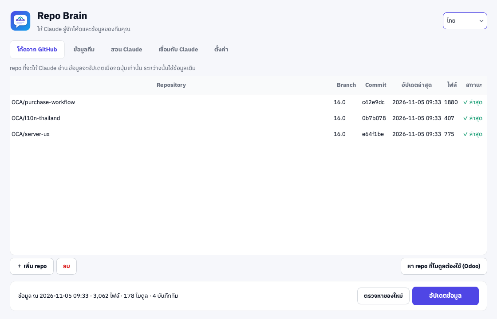

</div>

---

## สารบัญ

- [ทำอะไรได้บ้าง](#-ทำอะไรได้บ้าง)
- [ทำงานยังไง](#-ทำงานยังไง)
- [ติดตั้ง](#-ติดตั้ง)
- [เริ่มใช้แบบเร็ว: คนในทีมที่ได้ไฟล์ตั้งค่ามาแล้ว](#-เริ่มใช้แบบเร็ว-คนในทีมที่ได้ไฟล์ตั้งค่ามาแล้ว)
- [คู่มือตั้งค่าครั้งแรก (ผู้ดูแล)](#-คู่มือตั้งค่าครั้งแรก-ผู้ดูแล)
- [ใช้งานประจำวัน: ถามคำถามใน Claude Desktop](#-ใช้งานประจำวัน-ถามคำถามใน-claude-desktop)
- [สอน Claude: เคสจาก LINE และ flow การทำงาน](#-สอน-claude-เคสจาก-line-และ-flow-การทำงาน)
- [คำถามที่พบบ่อย / แก้ปัญหา](#-คำถามที่พบบ่อย--แก้ปัญหา)
- [Build เอง (สำหรับนักพัฒนา)](#️-build-เอง-สำหรับนักพัฒนา)

---

## ✨ ทำอะไรได้บ้าง

| ✨ ฟีเจอร์ | คำอธิบาย |
|---|---|
| 🧠 **Claude รู้จักโค้ดของคุณ** | เพิ่ม repo จาก GitHub แล้ว Claude Desktop ค้นและอ่านโค้ดได้ ตอบพร้อมอ้างอิง `repo/path:บรรทัด` |
| 🔘 **อัปเดตเมื่อกดปุ่มเท่านั้น** | ปกติใช้ข้อมูลชุดล่าสุดในเครื่อง พอกด **อัปเดตข้อมูล** จะดึงมาเฉพาะไฟล์ที่เปลี่ยน จึงเร็วมาก |
| 🔔 **รู้ว่ามีของใหม่** | ปุ่ม **ตรวจหาของใหม่** บอกว่า repo ไหนมี commit ใหม่โดยไม่ต้องโหลดโค้ด |
| 🧩 **เข้าใจ Odoo** | รู้ว่า model ถูกสร้างและถูก `_inherit` ที่โมดูลไหน มี field อะไร โมดูลพึ่งโมดูลไหน ค้นป้ายภาษาไทยจาก `th.po` และ view ได้ |
| 🔗 **หา repo ของ OCA ที่ขาดให้** | อ่าน `depends` แล้วบอกว่าโมดูลที่ขาดอยู่ใน repo ไหนของ OCA ตรงตามเวอร์ชัน Odoo |
| 👥 **ความรู้ของทีมที่แชร์กัน** | ทุกคนเพิ่มบันทึกได้ เก็บใน GitHub repo แบบ private หรือโฟลเดอร์แชร์ ทุกคนได้ข้อมูลเมื่อกดอัปเดต |
| 🎓 **สอน Claude จากเคสจริง** | เปิดไฟล์ export แชท LINE แอปแยกเป็นเคสและปิดชื่อ เบอร์ อีเมลให้ Claude วิเคราะห์ ถามจนเข้าใจ แล้วบันทึกหลังคุณยืนยัน |
| 🗺️ **สอน flow การทำงาน** | Claude สัมภาษณ์ทีละขั้นจนอธิบาย flow กลับได้ถูก แล้วเขียนเป็นคู่มือให้ทั้งทีม |
| 📦 **ตั้งค่าทั้งทีมด้วยไฟล์เดียว** | ผู้ดูแลส่งออกไฟล์ `.repobrain` คนอื่นนำเข้าก็ได้ repo ความรู้ทีม และ token ครบ |
| 🔑 **ใช้ Claude ของแต่ละคน** | ทำงานเป็น MCP server ของ Claude Desktop ใช้บัญชีและโควตาของแต่ละคน ไม่ต้องมี API key กลาง |
| 🔒 **ข้อมูลอยู่ในเครื่อง** | index เก็บในเครื่องคุณ ไม่มี server กลาง ข้ามไฟล์ `.env` key และไฟล์ binary ให้อัตโนมัติ |

---

## 🧭 ทำงานยังไง

```
GitHub (โค้ด + ความรู้ทีม) ──กด “อัปเดตข้อมูล”──▶ Repo Brain (index ในเครื่อง)
                                                   │  MCP
                                                   ▼
                                        Claude Desktop ของคุณ ◀── คุณพิมพ์ถาม
```

- **Repo Brain** คือหลังบ้าน: เก็บโค้ดและความรู้ มีปุ่มอัปเดต และเครื่องมือสอน Claude
- **Claude Desktop** คือหน้าแชท: คุณพิมพ์ถามที่นี่ แล้ว Claude ไปค้นจาก Repo Brain ให้เอง

---

## 📥 ติดตั้ง

ต้องมี [Claude Desktop](https://claude.ai/download) ติดตั้งและล็อกอินไว้ก่อน

**macOS 11+ (Apple Silicon)**
1. ดาวน์โหลด [RepoBrain-macOS.dmg](https://github.com/madara1150/repo-brain/releases/latest/download/RepoBrain-macOS.dmg) แล้วดับเบิลคลิกเปิด
2. ลาก **Repo Brain** ไปวางในโฟลเดอร์ **Applications** (ต้องทำ ห้ามเปิดจากในไฟล์ .dmg)
3. เปิดครั้งแรก: คลิกขวาที่ **Repo Brain** ใน Applications → **Open** → **Open** (เพราะแอปยังไม่ได้ลงชื่อกับ Apple ทำครั้งเดียว)

**Windows 10 / 11**
1. ดาวน์โหลด [RepoBrain-Windows-Setup.exe](https://github.com/madara1150/repo-brain/releases/latest/download/RepoBrain-Windows-Setup.exe) แล้วเปิด
2. ถ้าขึ้น “Windows protected your PC” กด **More info** → **Run anyway**
3. กด Next จนจบ แล้วเปิด **Repo Brain** จากเมนู Start

---

## ⚡ เริ่มใช้แบบเร็ว: คนในทีมที่ได้ไฟล์ตั้งค่ามาแล้ว

ถ้าผู้ดูแลส่งไฟล์ `.repobrain` มาให้ ทำแค่ 5 ขั้น

1. เปิด Repo Brain → แท็บ **ตั้งค่า** → กด **นำเข้าการตั้งค่าทีม…** แล้วเลือกไฟล์

   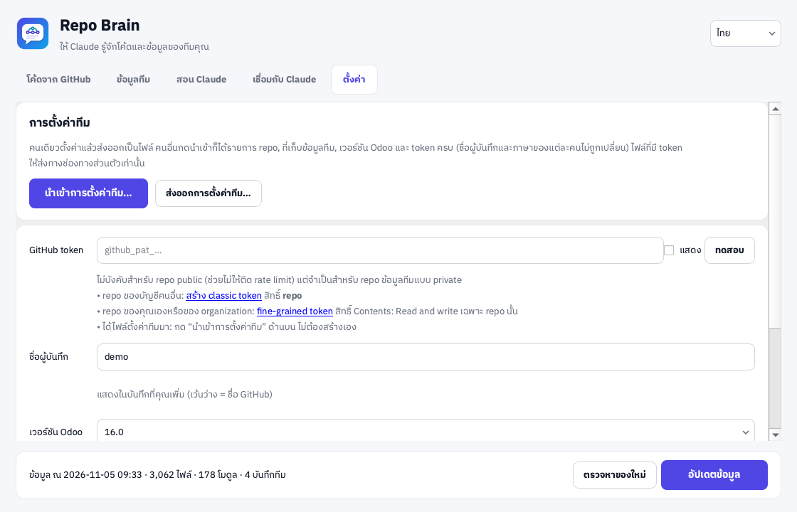

2. ตรวจรายการที่แอปสรุปให้ แล้วกด **ใช่**

   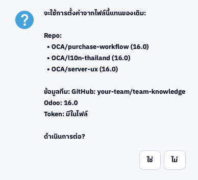

3. กรอก **ชื่อผู้บันทึก** (ชื่อที่จะแสดงในบันทึกที่คุณเพิ่ม)
4. กด **อัปเดตข้อมูล** ที่แถบด้านล่าง รอจนเสร็จ
5. ทำ [ขั้นที่ 7: เชื่อมกับ Claude Desktop](#7-เชื่อมกับ-claude-desktop) แล้วเริ่ม [ถามคำถาม](#-ใช้งานประจำวัน-ถามคำถามใน-claude-desktop) ได้เลย

---

## 🛠️ คู่มือตั้งค่าครั้งแรก (ผู้ดูแล)

ทำครั้งเดียวโดยคนที่ดูแลระบบ แล้วส่งออกเป็นไฟล์ให้ทั้งทีม

### 1. เพิ่ม repo ของระบบ

แท็บ **โค้ดจาก GitHub** → กด **＋ เพิ่ม repo** → ใส่ `owner/name` หรือวาง URL ของ GitHub → ใส่ branch (เว้นว่าง = branch หลักของ repo) → **ตกลง**

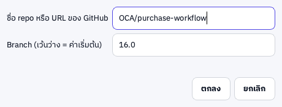

### 2. กด “อัปเดตข้อมูล”

ครั้งแรกจะโหลดทั้ง repo (หลายพันไฟล์ใช้ไม่กี่วินาที) ระหว่างนั้นกด **ยกเลิก** ได้

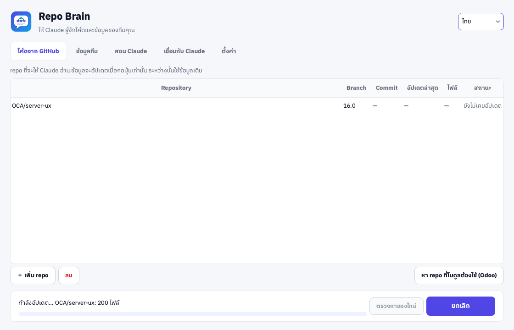

เสร็จแล้วตารางจะแสดง commit เวลาอัปเดตล่าสุด และจำนวนไฟล์ แถบล่างสรุปข้อมูลทั้งหมด


> ครั้งต่อไป กด **ตรวจหาของใหม่** เพื่อดูว่า repo ไหนมี commit ใหม่ แล้วค่อยกด **อัปเดตข้อมูล** ซึ่งจะดึงเฉพาะไฟล์ที่เปลี่ยน

### 3. (Odoo) เพิ่ม repo ของ OCA ที่โมดูลต้องใช้

1. แท็บ **ตั้งค่า** → เลือก **เวอร์ชัน Odoo** ให้ตรงกับระบบ (เช่น 16.0)
2. แท็บ **โค้ดจาก GitHub** → กด **หา repo ที่โมดูลต้องใช้ (Odoo)**
3. ติ๊กเลือก repo ที่ต้องการ → **เพิ่ม repo ที่เลือก** → กด **อัปเดตข้อมูล** อีกครั้ง

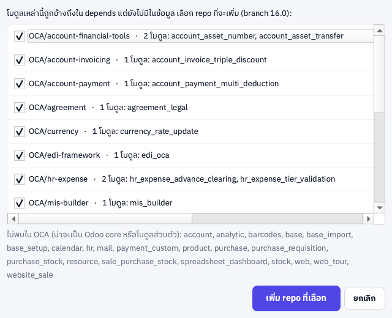

โมดูลที่ไม่พบใน OCA (เช่น `account`, `purchase`) เป็น Odoo core ไม่ต้องเพิ่ม

### 4. ตั้งที่เก็บความรู้ของทีม

1. สร้าง repo **แบบ private** บน GitHub เช่น `team-knowledge` (ห้ามใช้ repo public เพราะข้อมูลภายในจะเปิดเผย)
2. แท็บ **ข้อมูลทีม** → เลือก **GitHub repo แบบ private (แนะนำ)** → ใส่ `owner/team-knowledge` → ปล่อยโฟลเดอร์ย่อยเป็น `knowledge`

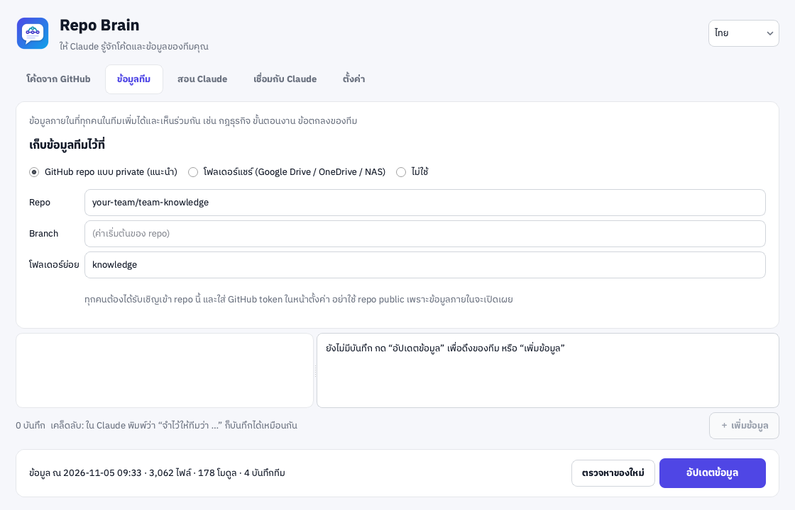

> ทางเลือก: **โฟลเดอร์แชร์** (Google Drive / OneDrive / NAS) ไม่ต้องใช้ token แต่ไม่มีประวัติการแก้ไข

### 5. สร้าง GitHub token

แนะนำให้ผู้ดูแลสร้าง **token กลาง** ตัวเดียวแล้วแจกผ่านไฟล์ตั้งค่าทีม

1. เปิด [สร้าง fine-grained token](https://github.com/settings/personal-access-tokens/new)
2. **Repository access** → **Only select repositories** → เลือก `team-knowledge`
3. **Permissions** → **Contents: Read and write** (อย่างเดียวพอ)
4. ตั้ง **Expiration** เช่น 1 ปี → **Generate token** → คัดลอก
5. แท็บ **ตั้งค่า** → วางในช่อง **GitHub token** → กด **ทดสอบ** ต้องขึ้น “ใช้ได้ — เข้าสู่ระบบเป็น …”


> ถ้าไม่ใช้ token กลาง: repo อยู่ใต้บัญชีของคนอื่น คนในทีมต้องใช้ [classic token](https://github.com/settings/tokens/new?scopes=repo&description=Repo%20Brain) สิทธิ์ `repo` (fine-grained token ใช้กับ repo ของบัญชีคนอื่นไม่ได้) ถ้าย้าย repo ไปไว้ใน GitHub organization ทุกคนจะใช้ fine-grained token ได้

### 6. ส่งออกไฟล์ตั้งค่าให้ทีม

แท็บ **ตั้งค่า** → **ส่งออกการตั้งค่าทีม…** → เลือกว่าจะใส่ token ในไฟล์ไหม → บันทึกไฟล์ `.repobrain`

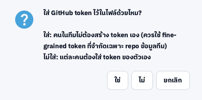

ส่งไฟล์ให้ทีม **ทางแชทส่วนตัวเท่านั้น** (ไฟล์มี token) ชื่อผู้บันทึกและภาษาของคุณไม่ถูกใส่ในไฟล์

### 7. เชื่อมกับ Claude Desktop

ทุกคนต้องทำบนเครื่องของตัวเอง

1. แท็บ **เชื่อมกับ Claude** → กด **เชื่อมกับ Claude Desktop**

   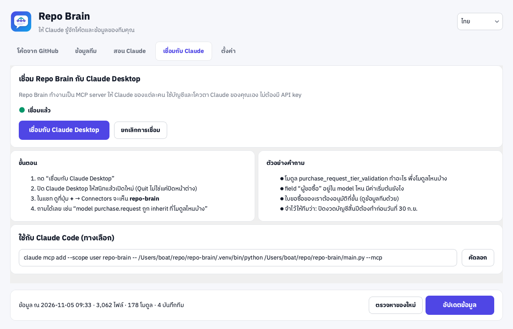

2. ขึ้นข้อความ “เชื่อมแล้ว” → กด **ตกลง**

   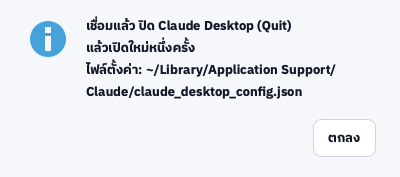

3. **ปิด Claude Desktop ให้สนิท** แล้วเปิดใหม่หนึ่งครั้ง
   - macOS: อยู่ที่หน้าต่าง Claude แล้วกด **⌘Q**
   - Windows: คลิกขวาที่ไอคอน Claude ใน system tray (มุมขวาล่าง) → **Quit**
4. ใน Claude Desktop เปิดแชทใหม่ → กดปุ่ม **+** ใต้ช่องพิมพ์ → **Connectors** → ดูว่ามี **repo-brain** และเปิดอยู่

---

## 💬 ใช้งานประจำวัน: ถามคำถามใน Claude Desktop

1. เปิด **Claude Desktop** → แชทใหม่
2. พิมพ์ถามเป็นภาษาปกติ เช่น
   - “ใบขอซื้อกดยืนยันไม่ได้ ขึ้นว่ายังไม่ได้เลือกแหล่งเงิน ต้องทำยังไง”
   - “model `purchase.request` ถูก inherit ที่โมดูลไหนบ้าง”
   - “field ‘ผู้ขอซื้อ’ อยู่ใน model ไหน มีค่าเริ่มต้นยังไง”
   - “ใบขอซื้อของเราต้องอนุมัติกี่ขั้น (ดูข้อมูลทีมด้วย)”
3. ครั้งแรกที่ Claude เรียกใช้ repo-brain จะถามขออนุญาต → กด **Allow** (เลือก allow ทุกครั้งได้)
4. Claude ตอบพร้อมบอกแหล่งที่มา เช่น `repo/path:บรรทัด` หรือชื่อบันทึกของทีม

**ให้ Claude จำเรื่องสั้นๆ:** พิมพ์ “จำไว้ให้ทีมว่า …” Claude จะร่างบันทึกให้อ่าน แล้วบันทึกเมื่อคุณยืนยัน

**เพิ่มบันทึกเองในแอป:** แท็บ **ข้อมูลทีม** → **＋ เพิ่มข้อมูล** → ใส่หัวข้อ แท็ก เนื้อหา → **บันทึกและแชร์**

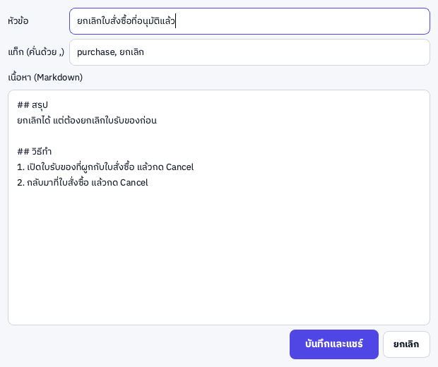

**ให้ข้อมูลเป็นปัจจุบัน:** เมื่อมีคนแก้โค้ดหรือเพิ่มบันทึก ให้กด **ตรวจหาของใหม่** → **อัปเดตข้อมูล** ในแอป ไม่ต้องปิด Claude Desktop

---

## 🎓 สอน Claude: เคสจาก LINE และ flow การทำงาน

แท็บ **สอน Claude** ใช้เปลี่ยนเคสถาม-ตอบจริงและความรู้ในหัวคนให้เป็นบันทึกของทีม

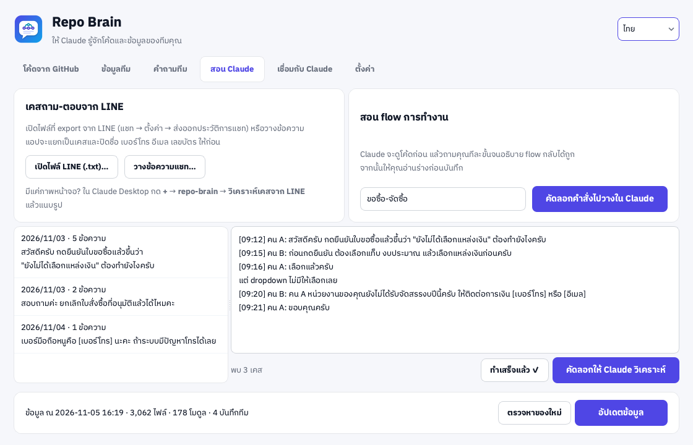

### A. เคสจากแชท LINE

1. **Export แชทจาก LINE**
   - มือถือ: เปิดแชท/กลุ่ม → เมนู **≡** มุมขวาบน → **การตั้งค่า** → **ส่งออกประวัติการแชท** → ส่งไฟล์ .txt มาที่คอมพิวเตอร์
   - LINE บนคอมพิวเตอร์: เปิดแชท → เมนู **⋮** → **บันทึกแชท**
2. ใน Repo Brain แท็บ **สอน Claude** → **เปิดไฟล์ LINE (.txt)…** (หรือคัดลอกข้อความจาก LINE แล้วกด **วางข้อความแชท…**)
3. แอปแยกเป็นเคสตามวันและช่วงเวลา ชื่อคนเปลี่ยนเป็น “คน A / คน B” และเบอร์โทร อีเมล เลขบัตร เลขบัญชี ถูกปิด
4. เลือกเคสทางซ้าย → **อ่านทวน** และลบส่วนที่ไม่เกี่ยวในกล่องขวา → กด **คัดลอกให้ Claude วิเคราะห์**

   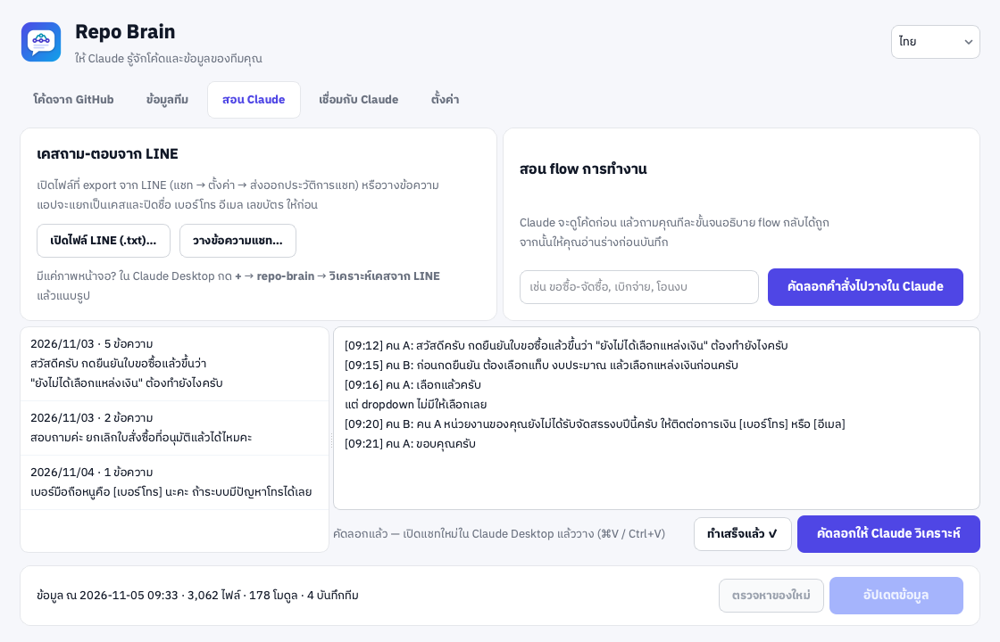

5. เปิด **แชทใหม่** ใน Claude Desktop → วาง (⌘V / Ctrl+V) → ส่ง
6. ตอบคำถามที่ Claude ถาม (ทีละ 1–3 ข้อ) จน Claude สรุปเคสได้ถูก
7. Claude แสดง **ร่างบันทึก** ทั้งฉบับ → ถ้าต้องแก้บอกได้เลย → ถ้าถูกแล้วตอบ “บันทึก”
8. Claude บันทึกขึ้น repo ความรู้ของทีม → กลับมาที่แอปกด **ทำเสร็จแล้ว ✓** แอปจะข้ามไปเคสถัดไป

> มีแค่ภาพหน้าจอแชท? ใน Claude Desktop กด **+** → **repo-brain** → **วิเคราะห์เคสจาก LINE** แล้วแนบรูป (ภาพจะไม่ถูกปิดข้อมูลอัตโนมัติ ควรเบลอชื่อและเบอร์ก่อน)

### B. สอน flow การทำงาน

1. แท็บ **สอน Claude** → พิมพ์ชื่อ flow เช่น “ขอซื้อ-จัดซื้อ” → **คัดลอกคำสั่งไปวางใน Claude**
   (หรือใน Claude Desktop กด **+** → **repo-brain** → **สอน flow การทำงาน**)
2. วางในแชทใหม่ของ Claude Desktop → ส่ง
3. Claude ดูโค้ดก่อน แล้วเล่าว่าระบบน่าจะทำงานยังไง ให้คุณ **แก้สิ่งที่ผิด** ไม่ต้องเล่าใหม่ทั้งหมด
4. Claude ถามไล่ตามลำดับ: ใครเริ่ม → ทำอะไรในระบบ → ส่งต่อใคร → อนุมัติกี่ขั้น → จบที่ไหน → กรณีตีกลับ/ยกเลิก
5. ทุก 2–3 รอบ Claude สรุปให้ตรวจ สุดท้ายจะ **อธิบายกลับทั้ง flow** จนคุณบอกว่าถูก
6. Claude แสดงร่างบันทึก → คุณยืนยัน → บันทึกขึ้น repo ความรู้ของทีม

### กติกาที่ Claude ทำทุกครั้ง

- ตรวจกับโค้ดจริง และบอกตรงๆ ถ้าที่เล่าไม่ตรงกับโค้ด
- ค้นบันทึกเดิมก่อน ถ้ามีเรื่องเดียวกันจะเสนอ **แก้บันทึกเดิม** แทนการสร้างซ้ำ
- ไม่ใส่ชื่อคน เบอร์โทร อีเมล หรือเลขเอกสารเฉพาะราย ใช้บทบาทแทน เช่น “เจ้าหน้าที่พัสดุ”
- **ไม่บันทึกจนกว่าคุณจะตอบยืนยัน** และติดป้ายประเภท (`case`, `flow`, `rule`, `howto`, `faq`) กับโมดูลที่เกี่ยวข้องไว้ในบันทึก

เครื่องมือที่ Claude ใช้: `repo_status`, `search_code`, `read_file`, `list_files`, `list_modules`, `odoo_module`, `odoo_model`, `search_knowledge`, `list_knowledge`, `add_knowledge`, `update_knowledge`, `check_for_updates` และ prompt สำเร็จรูป `analyze_line_case`, `teach_flow`

---

## ❓ คำถามที่พบบ่อย / แก้ปัญหา

<details>
<summary><b>macOS บอกว่า “ไม่สามารถเปิดได้เพราะไม่ได้มาจากนักพัฒนาที่ระบุตัวตน”</b></summary>

คลิกขวาที่ **Repo Brain** ใน Applications → **Open** → **Open** (ทำครั้งเดียว) หรือ **System Settings → Privacy & Security** → **Open Anyway**
</details>

<details>
<summary><b>Windows ขึ้น “Windows protected your PC” (SmartScreen)</b></summary>

กด **More info** → **Run anyway** เกิดขึ้นเพราะโปรแกรมยังไม่มีใบรับรอง code signing
</details>

<details>
<summary><b>ใน Claude Desktop ไม่เห็น repo-brain</b></summary>

1. **Quit** Claude Desktop ให้สนิทแล้วเปิดใหม่ (การปิดหน้าต่างอย่างเดียวไม่พอ)
2. ดูแท็บ **เชื่อมกับ Claude** ในแอป ต้องขึ้น “เชื่อมแล้ว” ถ้าขึ้น “เชื่อมไว้กับแอปตัวอื่น” ให้กดเชื่อมใหม่
3. ถ้าย้ายหรืออัปเดตแอป ให้กด **เชื่อมกับ Claude Desktop** อีกครั้ง
4. บน macOS ต้องลากแอปไปไว้ใน Applications ก่อนกดเชื่อม
</details>

<details>
<summary><b>Claude ตอบว่าไม่พบข้อมูล หรือข้อมูลเก่า</b></summary>

Claude ใช้ข้อมูลชุดที่อัปเดตล่าสุดในเครื่อง ให้กด **ตรวจหาของใหม่** → **อัปเดตข้อมูล** แล้วถามใหม่ ถ้าโมดูลอยู่ใน repo อื่น ให้เพิ่ม repo นั้นก่อน
</details>

<details>
<summary><b>เพิ่มบันทึกไม่ได้ / ขึ้น 401, 403 หรือ 404</b></summary>

ตรวจ token ในหน้า **ตั้งค่า** ด้วยปุ่ม **ทดสอบ**: token ต้องยังไม่หมดอายุ ต้องเข้าถึง repo ความรู้ของทีมได้ และมีสิทธิ์ *Contents: Read and write*
</details>

<details>
<summary><b>อัปเดตแล้วขึ้น “rate limit”</b></summary>

GitHub ให้เรียกได้ 60 ครั้งต่อชั่วโมงถ้าไม่มี token ใส่ token ในหน้า **ตั้งค่า** แล้วจะได้ 5,000 ครั้งต่อชั่วโมง
</details>

<details>
<summary><b>แยกเคสจากไฟล์ LINE ไม่ถูก</b></summary>

LINE แต่ละเวอร์ชันเขียนวันที่ต่างกันเล็กน้อย ถ้าแอปแยกผิด ให้คัดลอกเฉพาะช่วงแชทที่ต้องการแล้วใช้ **วางข้อความแชท…** แทน
</details>

<details>
<summary><b>ข้อมูลถูกส่งไปที่ไหนบ้าง</b></summary>

index อยู่ในเครื่องคุณเท่านั้น แอปติดต่อแค่ GitHub (อัปเดต ตรวจ เพิ่มบันทึก) และ PyPI (หา repo ของ OCA) ส่วนที่ Claude อ่านจะส่งผ่าน Claude Desktop ด้วยบัญชีของคุณ **อย่าเก็บข้อมูลภายในไว้ใน repo public**
</details>

<details>
<summary><b>ใช้กับ Claude Code ได้ไหม</b></summary>

ได้ แท็บ **เชื่อมกับ Claude** มีคำสั่ง `claude mcp add …` ให้คัดลอกไปรัน
</details>

---

## 🛠️ Build เอง (สำหรับนักพัฒนา)

```bash
python3 -m venv .venv && .venv/bin/pip install -r requirements.txt pytest Pillow
.venv/bin/python main.py            # เปิดแอป
.venv/bin/python main.py --mcp      # MCP server (Claude Desktop เป็นคนเรียก)
.venv/bin/python main.py --sync     # อัปเดตข้อมูลโดยไม่เปิดหน้าต่าง
QT_QPA_PLATFORM=offscreen .venv/bin/python -m pytest
QT_QPA_PLATFORM=offscreen .venv/bin/python tools/screenshots.py   # ภาพหน้าจอหลัก
QT_QPA_PLATFORM=offscreen .venv/bin/python tools/guide_shots.py   # ภาพทีละขั้นในคู่มือ
./build_mac.sh                      # → dist/RepoBrain-macOS.dmg
build_windows.bat                   # → dist\RepoBrain-Windows-Setup.exe + RepoBrain\ (portable)
```

push tag เช่น `v1.0.4` แล้ว GitHub Actions จะ build ทั้งสองระบบและสร้าง Release ให้

---

## 📄 License

[MIT](LICENSE) © 2026 Tanathip · ฟอนต์: IBM Plex Sans Thai ([OFL](assets/fonts/OFL-IBMPlexSansThai.txt))
